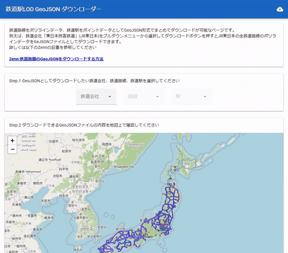

# 鉄道駅LOD GeoJSON ダウンローダー

[鉄道駅LOD](https://uedayou.net/jrslod/)からRDFデータを取得して、位置情報データをGeoJSONに変換して、Webブラウザ上からダウンロードが可能なVue.js製Webアプリです。

鉄道駅LODのデータを使って Webアプリを作るときの参考としても利用できます。

構成: Vue 3 + Vuetify 4 + Vuex 4 + Leaflet + Vite

### デモ

<https://uedayou.net/jrslod-geojson-downloader/>



## Project setup
```
npm install
```

### Compiles and hot-reloads for development
```
npm run dev
```

### Compiles and minifies for production
```
npm run build
```

### Locally preview the production build
```
npm run preview
```

### Lints and fixes files
```
npm run lint
```

### Customize configuration
See [Vite Configuration Reference](https://vite.dev/config/).
